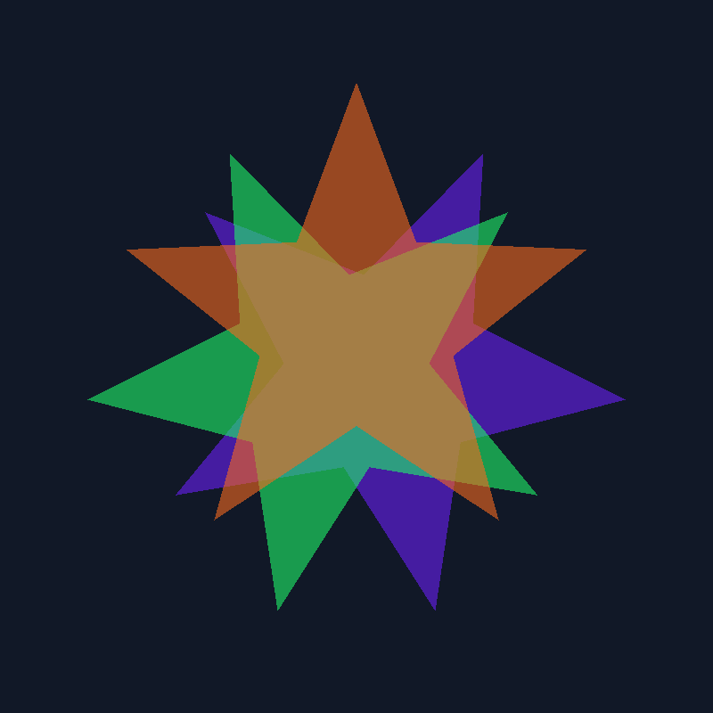
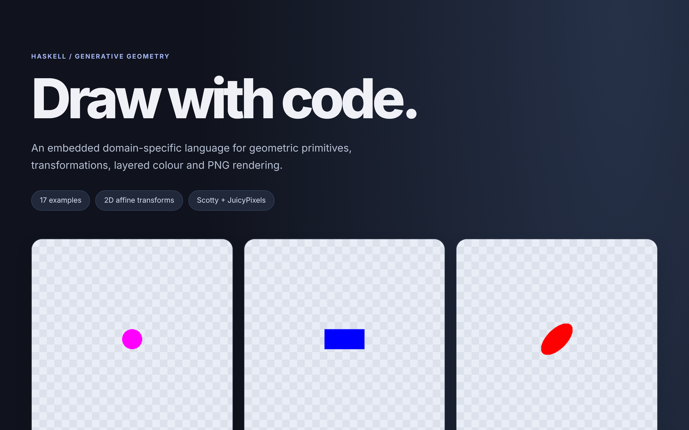
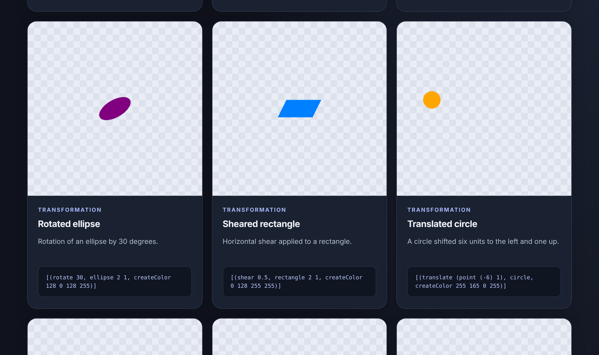
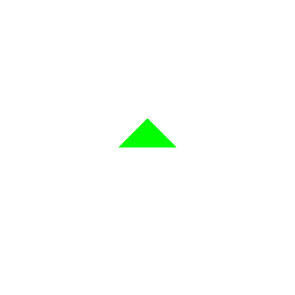
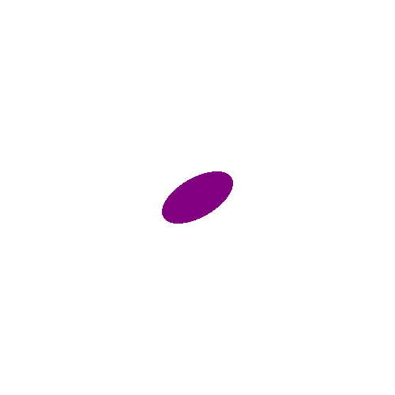
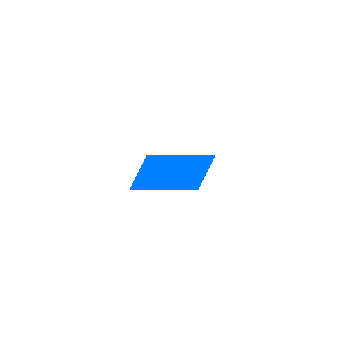
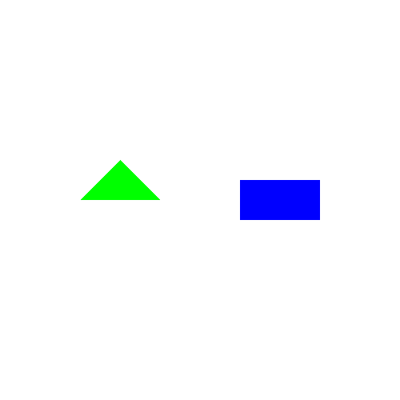
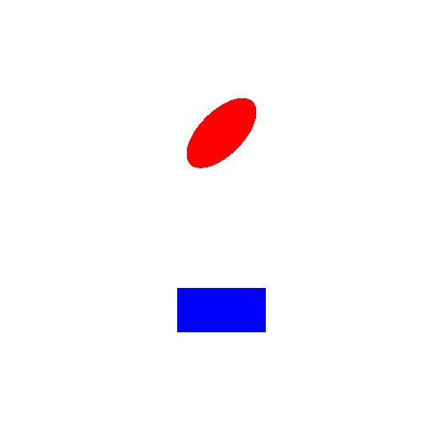
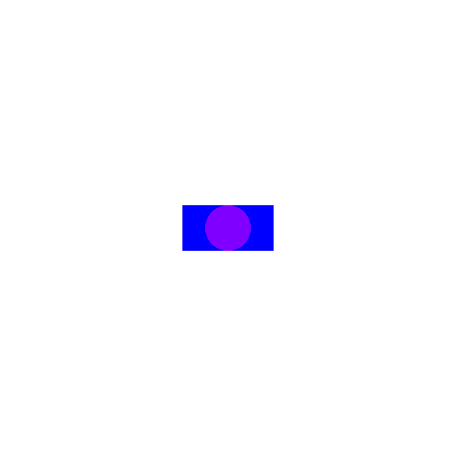
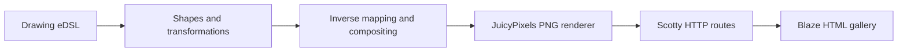

# Haskell Image Server

**A drawing language embedded in Haskell, a raster renderer with alpha compositing, and a web gallery that shows each picture next to the code that drew it.**

[](https://github.com/leahweldon/Haskell-Image-Server/actions/workflows/ci.yml)
[](https://www.haskell.org/ghc/)
[](https://docs.haskellstack.org/)
[](LICENSE)

<p align="center">
  
</p>

<p align="center"><em>Twelve translucent ellipses, each one rotated, coloured and blended by the renderer in this repository. 120 frames, one full turn.</em></p>

Built for **CSU44012 Topics in Functional Programming** at **Trinity College Dublin (2024–25)**. Pictures are written as ordinary Haskell values: shapes, affine transformations and RGBA colours. A renderer turns them into PNG images with **JuicyPixels**, and a **Scotty** server with **Blaze HTML** presents them as a gallery.

## Highlights

- **Drawing as data:** a picture is a list of `(Transform, Shape, Color)` values, so scenes are built with `map`, list comprehensions and plain functions.
- **Full 2D affine toolkit:** translate, rotate, scale and shear, composed with a single `<+>` operator and inverted exactly during rendering.
- **Any polygon:** an even-odd fill rule handles concave shapes such as stars.
- **Real transparency:** overlapping colours are blended with Porter–Duff source-over compositing.
- **Tested in CI:** nearly 40 checks covering geometry, transforms and their inverses, layering, pixel mapping and PNG output run on every push.

## Showcase

Both images below are produced by [`examples/Showcase.hs`](examples/Showcase.hs), which uses nothing beyond the drawing language and renderer.

| Rosette | Overlapping stars |
|:---:|:---:|
|  |  |
| Rotation and source-over blending | Concave polygons, scaling and blending |

The whole rosette is one list comprehension:

```haskell
rosette :: Double -> Drawing
rosette turn =
  [ ( translate (point 1.5 0) <+> rotate angle
    , ellipse 3 1
    , hue 120 angle
    )
  | k <- [0 .. 11 :: Int]
  , let angle = turn + 30 * fromIntegral k
  ]
```

Each petal is an ellipse pushed out from the centre and then rotated into place, with its colour picked from a colour wheel at alpha 120 so that overlapping petals mix. The animation calls `rosette` with a slightly larger `turn` for every frame.

## The Gallery



Running the server renders 17 examples and serves them on one page, each card showing the image, what it demonstrates and the exact expression that produced it.



| Circle | Polygon | Rotated ellipse | Sheared rectangle |
|:---:|:---:|:---:|:---:|
|  |  |  |  |
| `circle` | `polygon [...]` | `rotate 30` | `shear 0.5` |

| Circle over rectangle | Polygon left of rectangle | Rectangle below ellipse | Translucent layers |
|:---:|:---:|:---:|:---:|
|  |  |  |  |
| `over` | `left` | `below` | `switchingLayer 128` |

All 17 rendered examples are in [`docs/gallery/`](docs/gallery/).

## How It Works



### Drawing as Data

```haskell
type Drawing = [(Transform, Shape, Color)]

example :: Drawing
example =
  [ (rotate 30 <+> translate (point 2 0), ellipse 2 1, Color 180 90 240 180)
  , (identity, rectangle 2 1, Color 28 78 180 255)
  ]
```

The first entry is the front layer. Because a drawing is just data, composition operators such as `over`, `left` and `above` are short list functions, and the same description could be handed to a different backend.

### Rendering by Inverse Transformation

Scenes live in a mathematical coordinate space with y pointing up, while image pixels start at the top-left corner. For every output pixel the renderer:

1. converts the pixel to a world-space point;
2. applies the **inverse** of each shape's transformation to move that point into the shape's own unit space;
3. tests membership against the simple unit shape (`x² + y² ≤ 1` for a circle, for example);
4. blends the colours of every shape that contains the point, back to front.

Testing in local space keeps every shape definition tiny: a rotated, sheared, scaled ellipse needs no special geometry, only an inverted transform.

```haskell
inverseTransform :: Transform -> Point -> Maybe Point
inverseTransform (Compose first second) p =
  inverseTransform second p >>= inverseTransform first
```

A transform that cannot be inverted, such as a zero scale, returns `Nothing`, and the shape simply draws nothing.

### Alpha Compositing

Colours are non-premultiplied RGBA. Where shapes overlap, `sourceOver` combines them with the standard Porter–Duff formula, so a half-transparent red circle over a blue rectangle comes out purple, and uncovered pixels stay fully transparent.

### Project Layout

| Component | Responsibility |
|---|---|
| [`src/Shapes.hs`](src/Shapes.hs) | Shapes, transformations and their inverses, polygon fill, colours and compositing |
| [`src/Render.hs`](src/Render.hs) | Pixel-to-world mapping, per-pixel sampling and PNG output |
| [`app/Main.hs`](app/Main.hs) | The 17 gallery examples, layout operators and HTTP routes |
| [`examples/Showcase.hs`](examples/Showcase.hs) | Larger scenes and the animation frames |
| [`static/css/style.css`](static/css/style.css) | Gallery styling |
| [`test/Spec.hs`](test/Spec.hs) | Geometry, transform, layering and rendering tests |
| [`docs/Project-Report.pdf`](docs/Project-Report.pdf) | Project report with design rationale |

## Build and Run

Requires [Haskell Stack](https://docs.haskellstack.org/en/stable/). The project uses **Stackage LTS 22.43 (GHC 9.6.6)**; the first build downloads the compiler and libraries.

```bash
git clone https://github.com/leahweldon/Haskell-Image-Server.git
cd Haskell-Image-Server

stack build
stack exec haskell-image-server-exe
```

Open **http://localhost:3000**. The server renders every example into `generated/` before it starts listening, then serves the gallery. Run it from the repository root so it can find the stylesheet, and stop it with **Ctrl+C**.

### Tests and Showcase

```bash
stack test                             # geometry, transforms, layering and PNG output
stack exec showcase                    # writes docs/showcase/rosette.png and stars.png
stack exec showcase -- frames frames   # writes the 120 animation frames to frames/
```

## Routes

| Route | Response |
|---|---|
| `/` | Gallery of all 17 examples with their Haskell expressions |
| `/style.css` | Gallery stylesheet |
| `/images/<name>.png` | One rendered example, for instance `/images/colourLayers.png` |

Image requests are matched against the example list, so only the gallery's own images are served.

The [project report](docs/Project-Report.pdf) covers the drawing representation, affine transformations, colour model, relative positioning, rendering approach and web interface in more depth.

## License

Distributed under the [BSD 3-Clause License](LICENSE).
