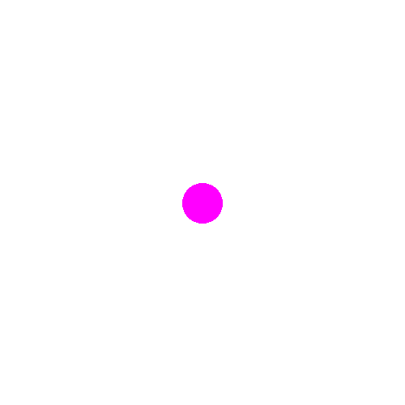
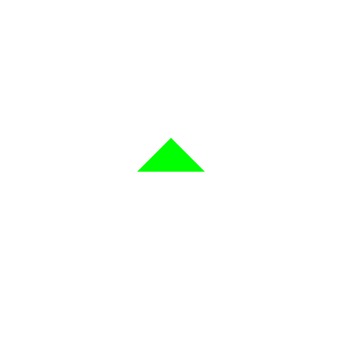
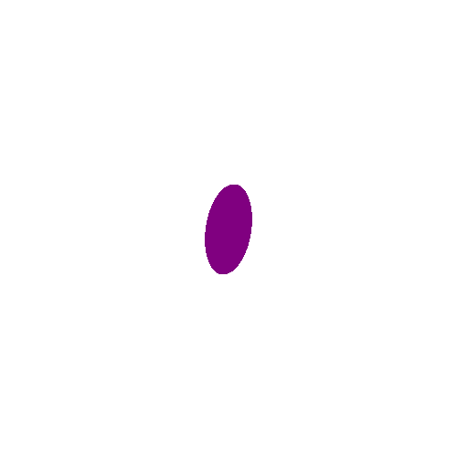
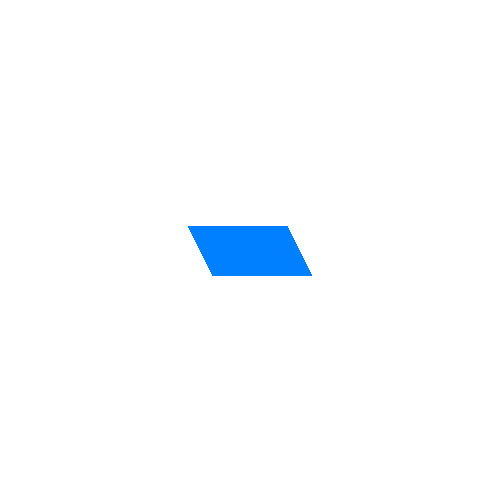
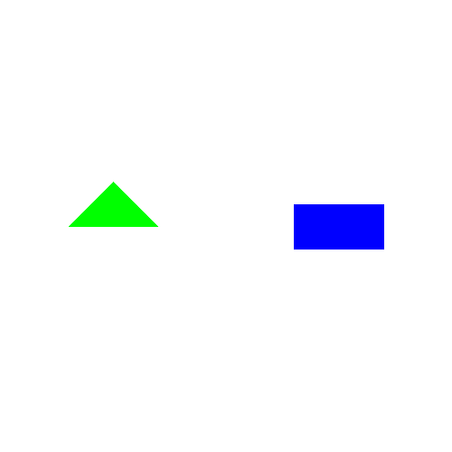
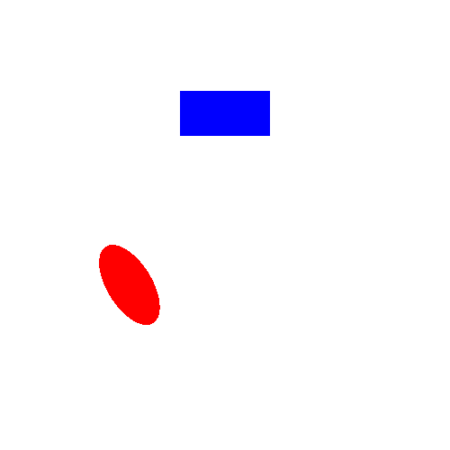
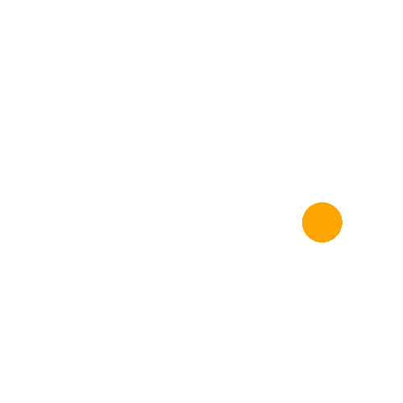
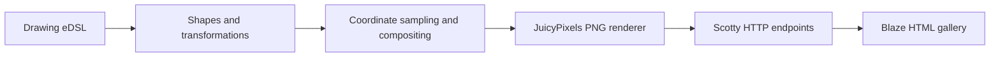

# Haskell Image Server

**A declarative drawing language, a raster rendering engine, and a web gallery - built in Haskell.**

[](https://www.haskell.org/ghc/)
[](https://docs.haskellstack.org/)
[](LICENSE)

A functional graphics application developed for **CSU44012 - Topics in Functional Programming** at **Trinity College Dublin (2024–2025)**. It uses an embedded domain-specific language (eDSL) to describe shapes, colours, affine transformations and drawing composition, renders them as RGBA PNG images using **JuicyPixels**, and serves an interactive gallery with **Scotty** and **Blaze HTML**.

## Gallery

These are preserved image outputs from the original coursework project.

| Circle | Polygon | Rotated ellipse | Sheared rectangle |
|:---:|:---:|:---:|:---:|
|  |  |  |  |

| Overlapping shapes | Horizontal composition | Vertical composition | Translated circle |
|:---:|:---:|:---:|:---:|
|  |  |  |  |

All **16 preserved PNG examples** are available in [`docs/gallery/`](docs/gallery/). The web application renders its examples when launched; generated files are written to the ignored `generated/` directory.

## Features

- **Typed geometric primitives:** circles, aspect-ratio rectangles, ellipses, polygons and empty shapes.
- **Composable transformations:** translation, rotation, anisotropic scaling, shearing and ordered transformation composition.
- **Declarative drawings:** each scene is a list of transformed shapes with RGBA colours.
- **Layering:** front-to-back drawing order and source-over alpha compositing.
- **Raster rendering:** world-to-pixel coordinate mapping and PNG export using JuicyPixels.
- **Web gallery:** a responsive gallery of 17 examples, including the underlying Haskell expressions.
- **HTTP image delivery:** Scotty routes for the gallery, stylesheet and whitelisted PNG examples.
- **Automated checks:** geometry, inverse transforms, polygon boundaries, layering, coordinate mapping and PNG output tests.

## Architecture



| Component | Responsibility |
|---|---|
| [`src/Shapes.hs`](src/Shapes.hs) | Drawing data types, shape membership, transformation algebra, colour composition |
| [`src/Render.hs`](src/Render.hs) | Pixel sampling, coordinate conversion, grayscale and RGBA PNG output |
| [`app/Main.hs`](app/Main.hs) | Example scenes, relative positioning operators, image generation and HTTP routes |
| [`static/css/style.css`](static/css/style.css) | Responsive gallery design and image presentation |
| [`test/Spec.hs`](test/Spec.hs) | Deterministic geometry, transformation, layering and PNG rendering tests |
| [`docs/gallery/`](docs/gallery/) | Preserved images generated for the coursework |
| [`docs/Project-Report.pdf`](docs/Project-Report.pdf) | Original academic report, design rationale and implementation discussion |

### Drawing as data

A drawing is represented as a list of `(Transform, Shape, Color)` triples:

```haskell
example :: Drawing
example =
  [ (rotate 30 <+> translate (point 2 0), ellipse 2 1, Color 180 90 240 180)
  , (identity, rectangle 2 1, Color 28 78 180 255)
  ]
```

The first entry is the foreground layer. Because a drawing is ordinary Haskell data, shapes and transformations can be composed without tying the description to a particular rendering backend.

### Coordinate systems and transformations

The scene is described in a mathematical coordinate space with the positive y-axis pointing upwards. Raster coordinates instead begin at the top-left corner of an image. The renderer converts each output pixel into world coordinates before evaluating the drawing.

Shape transformations are composed in their written order. During rasterisation, the corresponding inverse transformation maps world-space sample points into local shape coordinates. This keeps translation, rotation, scale and shear consistent with how the eDSL describes each drawing.

Rotations use **degrees**. Rectangles and ellipses are defined using an aspect ratio: the second dimension acts as the reference height.

### Alpha compositing

Shapes carry RGBA colours. Overlapping shapes use **source-over alpha compositing**, preserving transparency and blending the foreground and background contributions. Empty pixels remain transparent.

## Build and Run

### Requirements

- [Haskell Stack](https://docs.haskellstack.org/en/stable/) installed and on your `PATH`.
- Internet access for Stack's initial compiler and package downloads.
- A modern browser to view the gallery.

The project uses **Stackage LTS 22.43 / GHC 9.6.6**, declared in [`stack.yaml`](stack.yaml), and the dependencies listed in [`package.yaml`](package.yaml).

### 1. Clone the repository

```bash
git clone https://github.com/leahweldon/Haskell-Image-Server.git
cd Haskell-Image-Server
```

### 2. Build

```bash
stack build
```

### 3. Run

```bash
stack exec haskell-image-server-exe
```

Open **http://localhost:3000**. The application generates PNG files in `generated/`, then serves the gallery and individual image endpoints. Run the command from the repository root so the stylesheet path resolves correctly.

Stop the local server with `Ctrl+C`.

### 4. Run automated tests

```bash
stack test
```

The tests exercise the pure drawing engine and write/read a small RGBA PNG. A browser is not required for the test suite.

## Application Routes

| Route | Response |
|---|---|
| `/` | Gallery with all drawing examples and their Haskell expressions |
| `/style.css` | Stylesheet for the gallery |
| `/images/circle.png` | Circle example PNG |
| `/images/rotatedEllipse.png` | Rotated ellipse PNG |
| `/images/colourLayers.png` | Translucent overlap PNG |

The image endpoint accepts only names from the application's example collection.

## Project Documentation

The [original project report](docs/Project-Report.pdf) explains the assignment's objectives, drawing representation, affine transformations, colour modelling, relative positioning, rendering approach and web interface.

The project demonstrates how **functional composition** can express graphical scenes declaratively, while a separate interpreter handles pixel generation and HTTP presentation.

## Academic Context

**Institution:** Trinity College Dublin  
**Module:** CSU44012 - Topics in Functional Programming  
**Project:** Project 1 - Image Server  
**Academic year:** 2024-2025  
**Developer:** Leah Weldon  
**Language:** Haskell

## License

[BSD 3-Clause License](LICENSE).
